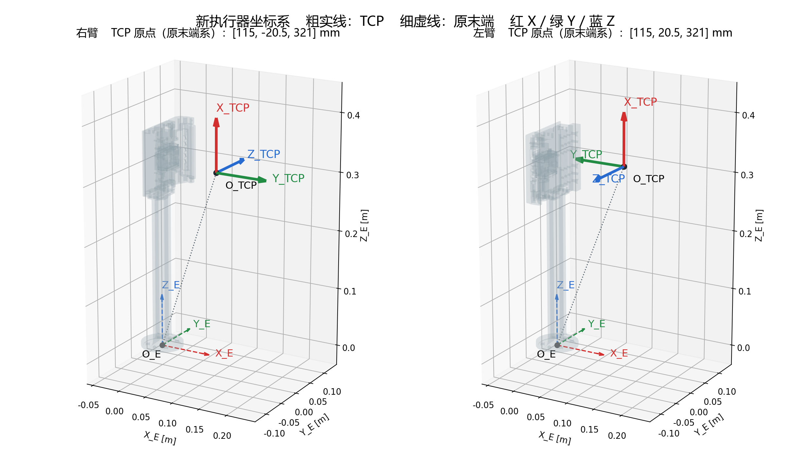

# GX12-02

以 2026-11-16 机器人 `.18` 标定后的本体、新搬料框执行器及配套运控为基线，2026-11-17 增加 DS485 自制夹爪接入。末端坐标系可视化已由用户确认。

## 2026-11-17：DS485 夹爪

`ControlGripper` 新增 `gripper_type=ds485`，经 Marvin 末端 485 透传控制德晟舵机，提供 `ros2 run motion_control_pkg ds485_gripper` 命令入口。默认夹爪类型仍为 `jodell`；取消、超时、通信异常及退出路径处理可能仍在运动的夹爪。协议、参数、动作和离线验证命令见 [DS485 说明](../../src/motion_control_pkg/doc/DS485_GRIPPER.md)。

本分支的 [GX12-02 部署配置](../../deployment/GX12-02/opt/onecube/motion_control/config/motion_control_config.yaml) 同步 11 月 17 日 `.18` 已交付配置：保留原有 43 项参数，增加 12 项夹爪参数；类型为 `ds485`，左侧张开/闭合为 -2.8°/27.2°，右侧 0°/0° 尚未标定，会拒绝运动。默认 PWM 为 1000；默认速度和配置速度上限为 0，实际由舵机 `0x5D` 只读查询约束，读取失败则拒绝动作。通用配置模板保持 `jodell` 和未标定角度，速度参数也采用 0 的默认语义。

本次发布复跑离线回归：协议 193 项、组合读取 5 场景、Action 13 场景全部通过。测试源码随分支提交，CTest 入口为 `ds485_offline`。增量文件哈希及验证范围见 [DS485 发布记录](ds485-publication.json)。

11 月 17 日此前交付已在 `.18` 完成编译安装；该次完整 CTest 为 26/30 通过。`leg_rigid_grasp`、`leg_rigid_execution`、`rigid_grasp`、`waist_leg_trajectory` 四项失败已用原版 GX12-02 源码复现，涉及标定模型与现有测试假设。此次 GitHub 发布未重新构建机器人或启动节点，也未执行真实夹爪动作；`0x5D` 实机读取、开合行为仍需硬件验收，右夹爪需独立标定。

## 2026-11-16 基线发布范围

从 `192.168.10.18:/home/it/ylf_wbc` 读取并逐文件核对 517 份源码、接口、模型、依赖及文档：

- `src/motion_control_pkg`：392 份文件。
- `src/com_interfaces`：35 份文件。
- `src/onecube_robot_description`：76 份文件，包括新执行器的完整视觉网格与简化碰撞网格。
- `vendor/driver_sdk`：10 份文件，包含原有符号链接。
- 机器人工作区根目录 `doc` 中的 4 份文档。

机器人实际配置另存于 [`deployment/GX12-02/opt/onecube/motion_control/config/motion_control_config.yaml`](../../deployment/GX12-02/opt/onecube/motion_control/config/motion_control_config.yaml)，现已随上述 DS485 增量更新。`bringup.launch.py` 仍读取机器人 `/opt/onecube/motion_control/config/motion_control_config.yaml`；构建源码不会自动覆盖它。

其他仓库组件保留 GitHub `main` 基线 `48f33de56a7e512d5917fdf5c149cd9631d51c8f` 的内容。基线发布范围内的文件以 .18 为准，11 月 16 日原始清单见 [source-manifest.json](source-manifest.json)；该清单保留当日证据，DS485 更新以增量发布记录为准。

### 与 main 的实现差异

本分支是 `.18` 当前源码快照。其中包含 DS485 夹爪通讯源码及普通 `gripper/Modbus_Jodell.h` 路径。`.18` 尚未合入 `main` 的双臂完成等待修复 `48f33de5`：本分支保留机器人现有的两个 `ArmCompletionGuard` 与最长 3 秒完成等待逻辑，未包含 `DualArmCompletionGuard`。后续需要该修复时，应单独合并并验证。

## 本体、末端与参数

本体同步了用户标定 URDF 的 20 组关节 `origin`，保留 .18 原有的全部位置、速度和力矩限制。其中 `body_joint` 速度限制为 `1.31 rad/s`，`head_yaw_joint` 和 `head_pitch_joint` 均为 `0.61 rad/s`。

保留原有 28 维关节拓扑及末端框架名称；旧夹爪零行程关节作为空兼容框架保留。新执行器的视觉和惯量使用夹持件零位，碰撞包络覆盖夹持件 `0..1.57 rad` 的完整行程，并保留原有碰撞对策略。

TCP 数组顺序为 `[x,y,z,qx,qy,qz,qw]`，平移单位为米，并在各自原末端坐标系 E 中表达：

| 机械臂 | TCP 参数 | 新坐标轴在 E 中的方向 |
| --- | --- | --- |
| 右臂 | `[0.115,-0.0205,0.321,-0.5,-0.5,-0.5,0.5]` | X=+Z，Y=+X，Z=+Y |
| 左臂 | `[0.115,0.0205,0.321,0.5,-0.5,0.5,0.5]` | X=+Z，Y=-X，Z=-Y |

平移数组不随新轴命名重新排列。轴向是固定安装变换；图示为离线几何，不代表实时反馈或实际工作姿态下与基座完全对齐。

动力学来自新末端 URDF，每侧空载质量 `0.80742 kg`；SDK 参数使用法兰坐标系，质心单位为 mm、惯量单位为 kg·m²。原 CAD 左支架质心 Z 位于实体外，适配模型按右支架镜像修正左支架质心 Z 及 `ixz/iyz`。该结果是模型标称值，未包含工件，也未经过负载辨识。

## 可视化

粗实线是新 TCP，细虚线是原末端坐标系；红 X、绿 Y、蓝 Z。

- [更换前后对比](tool-change-before-after.png)
- [碰撞包络](collision-preview.png)

## 基线验证与使用边界

11 月 16 日已完成下载快照与机器人 517 份文件的逐项 SHA-256/符号链接比对。当时模型与 `/opt` 配置的哈希如下；模型未随 DS485 改变，更新后的部署配置哈希见增量发布记录：

| 文件 | SHA-256 |
| --- | --- |
| `onecube_robot_description.urdf` | `7d094cd2f75304e65ed382a7985d0b875f54dbe0034c7b464994532c7c5d5d4d` |
| `/opt/.../motion_control_config.yaml` | `5ba2a0345c9620a16159c52ba210d9f5f202f90e3cde423f73b3a7f6e6b66d53` |

模型交付阶段的验证报告随本分支保存：100 组 FK 对照、全部原有关节限位、130 组几何碰撞对、7 个碰撞正例、独立动力学聚合和 .18 原生 WBC 模型检查均通过。

- [标定本体与碰撞验证](body-calibration-validation.json)
- [独立动力学验证](tool-dynamics-validation.json)
- [.18 WBC 模型检查](wbc-model-audit.json)
- [本次发布完整性检查](publication-validation.json)：暂存区 518 份源码/配置与清单一致，模型资源引用、TCP、原有关节限位及零位碰撞检查通过。工作区静态一致性检查为 0 errors、82 warnings、2 info，保留现有源码；原始模型、配置及审计报告中的换行与空白也原样保留。

11 月 16 日基线发布未重新构建整套控制器，未重启节点或下发机器人运动；源码发布不代表运行进程已加载本版本。后续 DS485 的构建与发布范围见上文。构建、依赖与配置路径见[完整运控手册](../MOTION_COMMANDS_AND_PARAMETERS.md)。
