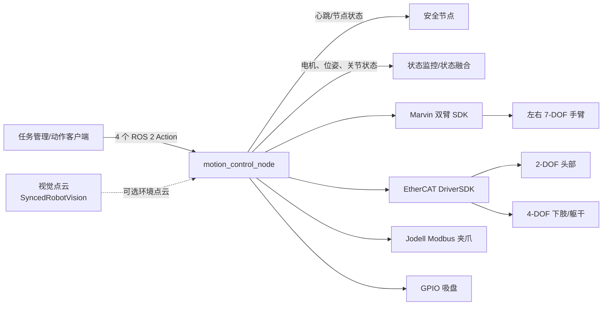
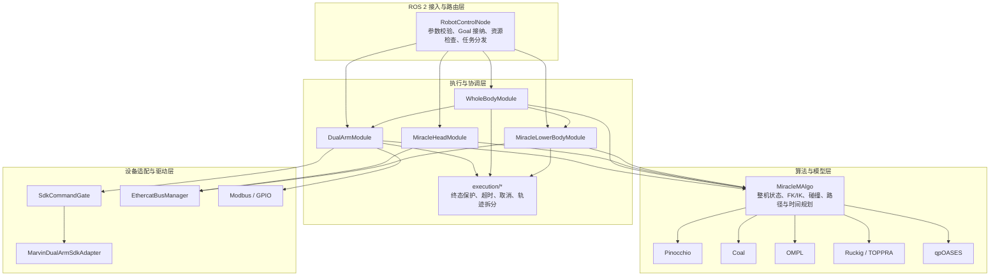
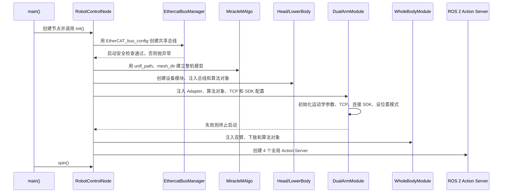
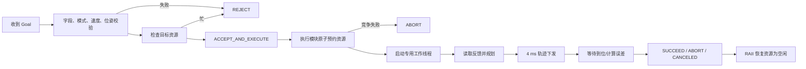

# `motion_control_pkg` 软件架构与功能说明

## 1. 文档范围

本文根据当前工程目录中的源码整理，主入口为 [`src/main_node.cpp`](../src/main_node.cpp)，构建边界以 [`CMakeLists.txt`](../CMakeLists.txt) 为准。文档描述的是当前代码行为，不把注释掉的接口、未编入目标的旧实现或仅存在于消息定义中的字段视为已经开放的功能。

`motion_control_pkg` 是整机运动控制 ROS 2 包。它把上层动作请求转换为双臂、头部、下肢和工具命令，并共享一套基于 URDF 的整机运动学与碰撞模型。当前生产可执行文件为 `motion_control_node`，语言标准为 C++17。

## 2. 核心功能

- 接收单臂、双臂、头部、下肢和“手臂 + 下肢”的运动请求。
- 支持关节空间运动、末端位姿运动和笛卡尔直线运动。
- 双臂支持位置模式、关节阻抗模式和笛卡尔阻抗模式。
- 使用 Pinocchio 完成整机模型、正逆运动学和坐标变换。
- 使用 Coal、OMPL 完成自碰撞/环境碰撞校验与无碰路径搜索。
- 使用 Ruckig 或 TOPPRA 对路径进行时间参数化，按 4 ms 周期下发。
- 通过 Marvin SDK 控制左右 7 自由度机械臂。
- 通过共享 EtherCAT 总线控制 2 自由度头部和 4 自由度下肢。
- 通过 Modbus 控制 Jodell 夹爪，通过 GPIO 控制左右吸盘。
- 发布心跳、节点状态、电机状态、头部位姿及头部/下肢关节状态。

## 3. 系统上下文



所有公开 Action 和状态 Topic 都使用以 `/` 开头的绝对名称，因此不会随 launch 中的节点命名空间变化。

## 4. 运行时分层



### 4.1 ROS 2 接入与路由层

`RobotControlNode` 定义在 `main_node.cpp` 中。它集中创建 Action Server，检查请求格式、目标部件是否空闲以及工具类型是否匹配，然后把 `goal_handle` 分发到对应模块。实际规划和设备访问不在 ROS 回调线程中执行。

### 4.2 执行与协调层

| 组件 | 主要职责 |
|---|---|
| `DualArmModule` | 双臂状态读取、单/双臂轨迹规划与下发、控制模式切换、TCP 误差计算、夹爪和吸盘控制、状态发布 |
| `WholeBodyModule` | 统一预约手臂和下肢资源，求解全身 IK，生成同源等长轨迹，并同步启动两路下发 |
| `MiracleHeadModule` | 头部反馈采集、关节轨迹生成、EtherCAT 轨迹下发、关节状态发布 |
| `MiracleLowerBodyModule` | 下肢反馈采集、关节/位姿轨迹生成、EtherCAT 下发，以及接收全身模块的预规划轨迹 |
| `MiracleModule` | 头部和下肢的公共基类，保存模块状态、关节数据、轨迹缓冲、总线及算法对象引用 |
| `execution/*` | Action 只结束一次的终态保护、单调时钟超时、协作式取消、忙闲标志恢复、4 ms 预规划轨迹分发和输入校验 |

### 4.3 算法与模型层

`MiracleMAlgo` 是全包共享的整机算法对象。它在启动时读取 URDF 和碰撞几何，定位左右臂、头部、下肢关节及末端 Frame，并维护一份带互斥保护的整机关节状态。

主要算法职责如下：

- Pinocchio：URDF 模型、FK、雅可比、单臂/双臂/全身 IK、模型内 Frame 变换和关节限位。
- Coal：对 Pinocchio 几何模型执行自碰撞和环境碰撞检测。
- OMPL：在启用碰撞检查时使用状态有效性回调搜索关节空间路径。
- Ruckig：对只有起点和终点的点到点运动进行时间参数化。
- TOPPRA：对 OMPL 多路点路径或笛卡尔离散路径进行时间参数化。
- qpOASES：全身 IK 中速度级 QP 的求解器。
- PCL/OctoMap：将 `PointCloud2` 转为模型根坐标系下的外部碰撞对象。

### 4.4 设备适配与驱动层

双臂设备链为：

```text
DualArmModule
  -> SdkCommandGate（串行化厂商命令事务）
  -> DualArmDeviceInterface（厂商无关接口）
  -> MarvinDualArmSdkAdapter
  -> libMarvinSDK.so / 双臂控制器 192.168.1.190
```

`SdkCommandGate` 使用互斥锁保护 Marvin SDK 的 `begin -> set -> commit` 事务，防止左右臂工作线程互相清空或交叉提交命令。Adapter 将厂商类型限制在实现文件内，便于离线 Fake 设备测试和后续替换 SDK。

头部和下肢共享单例 `EthercatBusManager`。总线管理器维护实际值快照和目标缓冲，在 250 Hz 循环中读写 PDO；使能电机前会检查通信、故障和状态字，退出时统一去使能。

## 5. 主函数与启动流程

`main()` 的流程很短：初始化 ROS 2，创建 `RobotControlNode`，调用 `init()`，成功后进入 `rclcpp::spin()`；任何初始化异常都会记录 FATAL、关闭 ROS 并以状态码 1 退出。

`RobotControlNode::init()` 的顺序如下：



启动采用 fail-fast 策略：EtherCAT 未就绪、URDF/规划 Frame 无效、工具参数非法、双臂 SDK 连接或初始化失败时，不进入 `spin()`。

## 6. ROS 2 接口

### 6.1 Action Server

Action 类型来自兄弟包 `com_interfaces`，而不是本包 `msg/` 目录。

| Action 名称 | 类型 | 支持对象 | 功能 |
|---|---|---|---|
| `/Control/move_pose` | `com_interfaces/action/MovePose` | 左臂、右臂、双臂、下肢、左/右/双臂全身模式 | TCP 位姿、下肢位姿和全身协同运动 |
| `/Control/move_joints` | `com_interfaces/action/MoveJoints` | 左臂、右臂、双臂、头部、下肢 | 关节目标运动 |
| `/Control/control_gripper` | `com_interfaces/action/ControlGripper` | 左、右或双夹爪 | Modbus 夹爪位置、速度、最大力矩控制 |
| `/Control/control_suck` | `com_interfaces/action/ControlSuck` | 左、右或双吸盘 | GPIO 开关控制 |

部件 ID 由 `main_node.hpp` 和 Action 定义共同约定：

| ID | 含义 | `MovePose` | `MoveJoints` |
|---:|---|---|---|
| 0 | 左臂 | 支持 | 支持 |
| 1 | 右臂 | 支持 | 支持 |
| 2 | 双臂 | 支持 | 支持 |
| 3 | 头部 | 不支持 | 支持 |
| 4 | 下肢 | 支持 | 支持 |
| 5 | 左臂 + 下肢 | 支持 | 不支持 |
| 6 | 右臂 + 下肢 | 支持 | 不支持 |
| 7 | 双臂 + 下肢 | 支持 | 不支持 |

对于双臂请求，当前只接受 `SYNC_START_AND_FINISH`，并要求 `timeout_ms > 0`。单臂关节请求必须提供完整且不重复的 7 个标准关节名；双臂请求分别提供左右各 7 个关节。

### 6.2 发布 Topic

| Topic | 类型 | 周期/触发 | 内容 |
|---|---|---|---|
| `/SafeNode/heartbeat` | `com_interfaces/msg/HeartBeat` | 1 s | 运控节点心跳 |
| `/SafeNode/status` | `com_interfaces/msg/NodeStatus` | 初始化时 | 节点 ID、初始化状态和错误标志 |
| `/Control/MotorInfo` | `com_interfaces/msg/MotorStatus` | 10 ms | 双臂关节位置、速度、电流/力矩和错误状态 |
| `/Control/HeadPose` | `com_interfaces/msg/MotorStatus` | 33 ms | 基于整机 FK 计算的头部末端位姿 |
| `/head_joint_states` | `sensor_msgs/msg/JointState` | 约 48 ms | 头部 2 关节反馈 |
| `/leg_joint_states` | `sensor_msgs/msg/JointState` | 约 48 ms | 下肢/躯干 4 关节反馈 |

### 6.3 可选点云输入

当单臂 `MovePose` 开启 `enable_collision_check` 时，环境点云有两种来源：

1. Goal 内的 `env_point_cloud`。
2. Goal 未携带点云且参数 `collision_pointcloud_topic` 非空时，临时订阅该 Topic 的 `com_interfaces/msg/SyncedRobotVision`，取其中 `camera_rgbd_pointcloud`，等待上限为 2 s。

点云会转换到模型根坐标系并临时加入碰撞场景，Action 结束后通过 RAII 移除。当前双臂和全身路径没有接入这条 Topic 取点云流程，只使用整机内部碰撞模型。

## 7. 动作处理与规划流程

### 7.1 通用处理框架



路由层的忙闲检查用于尽早拒绝请求；执行模块仍会原子预约资源，以关闭“检查后、占用前”的竞争窗口。`ActionTerminalGuard` 保证每个 Goal 最多进入一次终态。

### 7.2 `MoveJoints`

| 模式 | 规划与执行 |
|---|---|
| 单臂 | 校验关节名、软限位、URDF 限位和 CCS 第 6/7 轴组合约束；Ruckig 生成 4 ms 轨迹；经 Marvin SDK 下发；可选关节阻抗 |
| 双臂 | 从同一 SDK 快照取得起点；无碰撞时 Ruckig 点到点，有碰撞时 Coal/OMPL 规划 14 维联合路径并用 TOPPRA 参数化；每周期在同一 SDK 事务中提交左右臂命令 |
| 头部 | 校验 2 关节目标，使用 `computeMoveJTrajectory`/Ruckig 生成轨迹，经 EtherCAT 下发 |
| 下肢 | 校验 4 关节目标，使用 `computeMoveJTrajectory`/Ruckig 生成轨迹，经 EtherCAT 下发 |

单臂 `MoveJoints` 若设置 `enable_collision_check=true` 会在入口处被拒绝。头部和下肢代码读取该字段但目前没有用它改变规划或执行行为。

### 7.3 `MovePose`

单臂目标语义是工具 TCP 位姿。执行时先把任意模型内 `frame_id` 的目标转换到 `dual_arm_planning_frame`，再反解固定的“模型末端到工具 TCP”变换：

```text
目标 TCP -> 模型末端目标 -> Pinocchio 模型根坐标 -> IK/路径规划
```

- `enable_move_line=false`：先求目标 IK；不开碰撞时形成起终两点并使用 Ruckig，开碰撞时使用 Coal/OMPL 生成多路点路径并使用 TOPPRA。
- `enable_move_line=true`：按平移和旋转步长离散笛卡尔线，逐点连续 IK，再用 TOPPRA 参数化；规划结果还会检查直线偏差并在必要时细化。
- 所有 4 ms 采样点都会再次检查关节限位和 CCS 第 6/7 轴组合约束；启用碰撞时还会逐采样点复检。
- 执行完成后通过 FK 计算实际 TCP 与目标 TCP 的位置误差。

虽然接口注释把 `bound_size` 描述为工具/负载包络，当前单臂、双臂和全身实现实际将其三个分量直接加到目标位置的 X/Y/Z；它现在是目标平移偏移量，并没有改变碰撞几何尺寸。

双臂 `MovePose` 使用显式左右目标，从同一状态快照规划联合运动。直线模式调用双臂笛卡尔直线规划；普通模式按是否启用碰撞选择 IK 或 OMPL 路径，再统一时间参数化和原子批量下发。

下肢 `MovePose` 把目标约束在 4 自由度机构可表达的平面内，强制目标 `y=0`，通过下肢 IK 和 Ruckig 生成轨迹。

### 7.4 全身 `MovePose`

全身模式的活动自由度为“被选中的 7/14 个手臂关节 + 4 个下肢/躯干关节”，头部不参与。

1. 原子预约所需手臂和下肢资源。
2. 从共享 `MiracleMAlgo` 取得整机起始状态，并把目标转换到规划坐标系。
3. 求解带腿部权重、关节限位、CCS 约束及可选碰撞约束的全身 IK。
4. 开启碰撞时用 OMPL 规划全身联合路径；不开碰撞时直接使用起终点。
5. 两点路径用 Ruckig，多路点路径用 TOPPRA；直线模式按笛卡尔插值逐点求全身 IK。
6. 将同一条活动关节轨迹拆为左臂、右臂和下肢等长采样序列。
7. 双臂与下肢先分别完成准备，再使用共同的 `steady_clock` 起点并行下发；任一路失败会请求另一条路径停止后续采样。

这保证了全身动作的轨迹同源、样本数一致、首帧同步和失败联动。这里的取消是协作式停止后续样本，不等价于硬件急停。

### 7.5 工具控制

- `ControlGripper` 只允许控制配置为 `gripper` 的一侧。左右夹爪可使用独立工作线程；执行时读取状态、发送绝对位置命令并持续发布位置/力矩/速度反馈。由于没有经过验证的物理停止命令，入口会拒绝取消请求。
- `ControlSuck` 只允许控制配置为 `suck` 的一侧。左吸盘对应 GPIO4_B2，右吸盘对应 GPIO4_B0；GPIO 写入立即完成，因此取消请求被拒绝。退出时会关闭吸盘输出并释放 GPIO。
- 手臂资源和工具资源分别维护忙闲标志，因此手臂运动与同侧工具动作在资源模型上可以并发；上层仍需根据具体工艺确认这种并发是否合适。

## 8. 状态、线程与实时周期

### 8.1 共享状态

- 双臂反馈由 Marvin SDK 读取，角度从度转换为弧度后更新 `left_arm`、`right_arm` 模型链。
- 头部、下肢反馈线程从 `EthercatBusManager` 的快照读取并更新 `head`、`leg` 模型链。
- `MiracleMAlgo` 把各链数据合并到一份完整 Pinocchio 构型；关节状态和 Pinocchio/碰撞数据分别由互斥锁保护。

全身规划因此依赖双臂、头部和下肢反馈线程持续刷新同一个模型对象，而不依赖外部 TF 发布器完成机器人内部坐标转换。

### 8.2 线程模型

- ROS 主线程：参数、Goal/Cancel/Accepted 回调和定时器回调。
- EtherCAT 总线线程：250 Hz PDO 状态采集和目标下发。
- 头部反馈线程、下肢反馈线程：读取总线快照并发布关节状态。
- 动作工作线程：按左右臂、双臂、头部、下肢、工具和全身动作分别管理。
- 全身执行内部再用两个异步任务同步下发手臂与下肢轨迹。

所有关节/位姿轨迹使用 `TRAJ_CYCLE_US=4000`，即 4 ms/250 Hz。已实现超时的路径使用 `std::chrono::steady_clock`，不受系统时间校准影响。

## 9. 参数配置

launch 文件为 [`launch/bringup.launch.py`](../launch/bringup.launch.py)，示例参数为 [`launch/config/motion_control_config.yaml`](../launch/config/motion_control_config.yaml)。

### 9.1 启动与模型参数

| 参数 | 默认/launch 来源 | 作用 |
|---|---|---|
| `EtherCAT_bus_config` | launch 的 `driver_config`，默认 `/opt/onecube/driver_sdk/configuration.xml` | EtherCAT DriverSDK 配置 |
| `urdf_path` | `onecube_robot_description` 包中的 URDF | Pinocchio 整机模型 |
| `mesh_dir` | 机器人描述包父目录 | URDF 碰撞网格资源根目录 |
| `active_arm_configuration` | `dual_arm` | 当前只接受双臂配置，单臂独占模式已移除 |
| `dual_arm_planning_frame` | `base_link` | 外部 TCP 目标的统一规划 Frame，必须存在于模型中 |
| `collision_pointcloud_topic` | 空字符串 | 单臂碰撞规划的可选 `SyncedRobotVision` 来源 |

### 9.2 关节与工具参数

| 参数组 | 作用 |
|---|---|
| `head_joint_zero`, `head_joint_dir` | 已声明并读取；原始编码器换算代码当前被注释，现有反馈直接使用 DriverSDK 的 `pos/vel` |
| `leg_joint_zero`, `leg_joint_dir` | 已声明并读取；原始编码器换算代码当前被注释，现有反馈直接使用 DriverSDK 的 `pos/vel` |
| `left_arm_tool`, `right_arm_tool` | 每侧工具类型，只允许 `gripper`、`suck`、`none` |
| `left_arm_tool_tf`, `right_arm_tool_tf` | 模型末端/SDK 法兰到工具 TCP 的 `[x,y,z,qx,qy,qz,qw]`，平移单位为米 |
| `*_joint_impedance_*` | 左右臂关节阻抗刚度、阻尼、速度比和加速度比 |
| `*_cartesian_impedance_*` | 左右臂笛卡尔阻抗刚度、阻尼、速度比和加速度比 |
| `left_tool_dynamics`, `right_tool_dynamics` | 工具质量、质心和惯量参数，供 Marvin SDK 阻抗模式使用 |

示例 YAML 中的 `left/right_arm_joint_zero`、`left/right_arm_joint_dir`、`left/right_arm_joint_ratio` 和 `tf_lookup_timeout_sec` 当前没有 C++ 代码消费者，修改它们不会改变现有节点行为。

### 9.3 launch 注意事项

- launch 后节点完整名称为 `/motion_control_ns/motion_control`；构造函数中的默认名 `robot_control_node` 会被 launch 的 `name` 覆盖。
- 参数文件当前硬编码为 `/opt/onecube/motion_control/config/motion_control_config.yaml`，不是包内安装的示例 YAML。部署环境必须提供该文件。
- `driver_config` 只传给 `EtherCAT_bus_config`；Marvin 运动学配置固定从安装后的 `motion_control_pkg/config/ccs_m6_40.MvKDCfg` 读取。
- 双臂控制器 IP 当前固定为 `192.168.1.190`，不是 ROS 参数。

## 10. 构建与平台差异

```bash
colcon build --packages-select com_interfaces motion_control_pkg
source install/setup.bash
ros2 launch motion_control_pkg bringup.launch.py
```

主要构建依赖包括 ROS 2 `rclcpp/rclcpp_action`、Eigen、Pinocchio、Coal、OMPL、Ruckig、TOPPRA、qpOASES、PCL、OctoMap、FCL、JsonCpp、Marvin SDK 和 Loong DriverSDK。

| 平台 | EtherCAT/吸盘实现 | 动态库选择 |
|---|---|---|
| `aarch64/arm64` | 真正的 Loong DriverSDK 和 GPIO 实现 | `lib/aarch64`、TOPPRA aarch64 及 `/opt/onecube/driver_sdk` 库 |
| x86_64 | `ethercat_bus_manager_fake.cpp`、DriverSDK stub 和 fake GPIO | `lib/x64`、TOPPRA x64 |

x86_64 分支用于开发和离线运行头部/下肢总线逻辑，但双臂模块仍通过所链接的 x64 Marvin 库及 Adapter 初始化，不能简单等同于整个节点完全无硬件依赖。

## 11. 目录与代码职责

```text
motion_control_pkg/
├── src/main_node.cpp                  # ROS 2 入口、模块装配、Action 路由
├── src/dual_arm_module.cpp            # 双臂、夹爪、吸盘和状态发布
├── src/whole_body_module.cpp          # 手臂 + 下肢联合规划与同步执行
├── src/miracle_{head,lower_body}_module.cpp
│                                       # EtherCAT 部件控制
├── src/miracle_m_algo.cpp             # 整机模型与规划算法核心
├── src/sdk/                            # Marvin Adapter 与命令事务门
├── include/motion_control_pkg/
│   ├── execution/                     # 执行期通用基础设施
│   ├── kinematics/                    # 位姿/工具坐标转换
│   ├── motion/                        # 轨迹采样、校验、单位转换
│   └── sdk/                           # 厂商无关设备接口
├── launch/                            # bringup 与示例参数
├── config/                            # Marvin 运动学配置
├── test/                              # 厂商无关离线单元测试
├── 3rdparty/                          # qpOASES、TOPPRA、Quill、TRAC-IK 文件
└── lib/{aarch64,x64}/                 # 预编译 MarvinSDK/Kine 库
```

`src/common/mpc`、`src/common/wbc`、旧 `fcl_wrapper/ompl_wrapper`、`src/utils` 等源码当前未列入 `motion_control_node` 的 `SOURCES`。`3rdparty/trac_ik` 也未被当前 CMake 目标引用。本包的 `msg/*.msg` 没有调用 `rosidl_generate_interfaces`，运行时实际使用 `com_interfaces` 中的消息与 Action。

## 12. 安全与失败处理

- 节点只有在 EtherCAT、模型、工具参数和双臂初始化全部成功后才开放 Action Server。
- 运动前检查设备故障、静止状态、关节限位、非有限值和资源占用。
- 双臂命令使用一个 SDK 原子事务提交，避免左右轨迹在同一周期错位。
- EtherCAT 目标只有在电机通过通信/故障/使能检查后才能写入。
- 规划开启碰撞检查时，既检查 OMPL 路点，也复检时间参数化后的 4 ms 采样点。
- 轨迹线程在所有返回路径上释放忙闲标志，Action 终态由守卫防止重复提交。
- 析构时等待工作线程，释放 Marvin SDK，关闭吸盘并让 EtherCAT 总线去使能。

需要注意：软件取消的语义是停止继续下发采样点，代码明确说明它不是厂商软急停或物理急停。系统级急停必须由独立安全链路保证。

## 13. 当前限制与边界

- `MovePose.use_force_control` 和 `hand_action_type` 当前会被拒绝，尚未实现力控与随动手动作。
- 单臂 `MoveJoints` 的碰撞规划未接入，设置碰撞检查会被拒绝。
- 头部/下肢直接动作的 `enable_collision_check` 当前被读取但没有实际作用。
- 头部/下肢直接动作没有执行 `timeout_ms`，并且不使用双臂的阻抗 `control_mode` 配置流程。
- `bound_size` 当前被解释为目标 XYZ 偏移，而不是工具/负载碰撞包络尺寸；下肢直接 `MovePose` 不使用该字段。
- 动态环境点云目前只接入单臂 `MovePose`；双臂和全身动作未导入 Goal/Topic 点云。
- 头部不支持 `MovePose`，也不参与全身 IK。
- 双臂只支持 `active_arm_configuration=dual_arm` 和 `SYNC_START_AND_FINISH`。
- 夹爪和吸盘 Action 不接受取消；夹爪原因是缺少验证过的物理停止命令，吸盘原因是 GPIO 命令立即完成。
- `/SafeNode/status` 当前只在构造时发布一次 `STATE_INIT`，代码中没有完整运行态/故障态状态机。
- Action 与 Topic 使用绝对名称，多机器人或多实例部署时会发生名称冲突，除非通过 ROS 重映射处理。
- launch 参数文件路径、双臂控制器 IP 和部分设备路径为固定值，部署可移植性受限。
- 包版本仍为 `0.0.0`，`package.xml` 中 license 尚为 `TODO`。

## 14. 测试覆盖

当前 CMake 注册的离线测试包括：

- `test_sdk_command_gate`：SDK 事务顺序、失败传播、阻抗切换及并发串行化。
- `test_dual_arm_pose_transforms`：左右目标独立转换、缺失 Frame 失败和 TCP 偏移往返。
- `test_cartesian_line_sampling`：直线采样、偏差度量及 TOPPRA 路径准备。
- `test_gripper_worker_threads`：左右夹爪线程并行和同侧复用等待。
- `test_toppra_stable_solver`：正向/反向路径的稳定求解。
- `test_merged_planning`：整机状态、点云转换/碰撞、全身 IK 和消息序列化。
- `test_preplanned_dispatch`：全身轨迹拆分、同步起点、取消与子任务失败联动。

这些测试重点覆盖厂商无关核心逻辑。当前没有自动化测试完整启动 `motion_control_node`、连接真实硬件或端到端调用四个 Action；真机通信、制动释放、到位精度和急停链路仍需单独验收。

## 15. 推荐阅读顺序

1. [`src/main_node.cpp`](../src/main_node.cpp)：理解初始化、接口和路由。
2. [`include/motion_control_pkg/dual_arm_module.hpp`](../include/motion_control_pkg/dual_arm_module.hpp) 与 [`src/dual_arm_module.cpp`](../src/dual_arm_module.cpp)：理解主要动作执行链。
3. [`src/whole_body_module.cpp`](../src/whole_body_module.cpp)：理解资源预约和全身同步。
4. [`include/motion_control_pkg/miracle_m_algo.hpp`](../include/motion_control_pkg/miracle_m_algo.hpp) 与 [`src/miracle_m_algo.cpp`](../src/miracle_m_algo.cpp)：理解模型、IK、碰撞和时间规划。
5. [`src/miracle_head_module.cpp`](../src/miracle_head_module.cpp)、[`src/miracle_lower_body_module.cpp`](../src/miracle_lower_body_module.cpp) 和 [`src/ethercat_bus_manager.cpp`](../src/ethercat_bus_manager.cpp)：理解 EtherCAT 部件链。
6. [`include/motion_control_pkg/sdk/dual_arm_device_interface.hpp`](../include/motion_control_pkg/sdk/dual_arm_device_interface.hpp) 与 [`include/motion_control_pkg/sdk/sdk_command_gate.hpp`](../include/motion_control_pkg/sdk/sdk_command_gate.hpp)：理解硬件隔离和事务边界。
