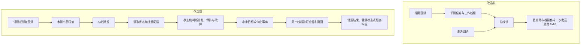

# 双夹爪控制与台架验收

本工作空间控制两个独立的德晟舵机。左侧使用 A 臂 COM1，右侧使用 B 臂 COM1，两侧的 ID 都可以是 1。ROS 的 `side` 分别为 0 和 1，`side=2` 让两侧分别执行并返回各自的结果。

## 现有证据

| 观察 | 已能确认 | 仍需现场验证 |
| --- | --- | --- |
| 旧版运动 | 基线 `475e30a` 的 `OnCommand → WorkerLoop → StartJob → Ds485Gripper::StartMove → Ds485Servo::MoveAngle` 一次写入最终 `0x66` 目标。后续 `Update` 只读状态。静止且未到目标可被旧逻辑判成夹物 | 旧版有持续位置误差和负载升高的条件。右侧超时当刻的力、电流、温度及物体状态没有同步测量 |
| 右侧结果 5 | 日志中的 `0x01` 是读取状态寄存器。300 ms 来自舵机应答等待。ROS 话题回调已收到命令。旧版有效但不匹配的帧还可能开启新的等待窗口 | 当时未保留原始字节。断线、设备未响应、透传丢包、换向延迟等原因需要通过双端抓包区分 |
| 旧版并发 | 话题通过每侧工作线程访问舵机，调试服务在 ROS 回调内取得同侧总线锁。锁保证一问一答，持锁时服务和运动互相等待 | 控制器内部 UART 的发送完成时刻及实际换向信号无法从 SDK 发送槽判断 |
| 左侧往返 | 历史脚本的 `-2.7° → +27.3° → -2.7°` 指令得到 `+27.2°` 和 `-2.5°` 反馈，现场确认先闭合再张开 | 这次试验使用 `0x66`。当前设备 YAML 的左侧端点为 0.2° / 98.1°，右侧端点为 57.9° / 167.6°，均需与当前装配核对 |
| 硬件保护 | 旧记录里左侧 `0x32=0x0D`，电流保护使能位当时为 0。上电时输出 `PROTECTION_INVENTORY` 记录本次实读值 | 两侧当前使能位、额定电流、持续保持电流、热边界和安全停止方式需分别确认 |

协议依据为随仓库的《第五版协议》。第 3～4 页规定帧格式和应答，第 13 页列出状态单位，第 15 页给出速度限制地址 `0x5D`，第 17 页要求 `0x69` 的目标以 20～100 Hz 更新，加减速由主机负责。

## 接口、调度和故障

下图以单侧为例。两个工作线程各自管理一条物理总线。



沿一次请求有四个可观察阶段。

1. ROS 回调受理请求并交给对应侧的工作线程。每侧只留一个待执行目标。停止请求优先，可以打断在途普通事务。维护请求有一个待处理位置，繁忙时返回 `BUSY`。
2. 总线线程组帧。Marvin 的发送成功表示 SDK 发送槽已受理。USB 串口检查内核发送队列排空。两种接口都无法测量末端总线上最后一个停止位的物理时间。
3. 事务层验证应答。读必须有匹配的长帧，故障短帧作为错误记录。单播普通写按 `0x11` Bit 3 决定是否等短应答。无应答写记录 `TX_NO_ACK_EXPECTED`。写操作不自动重发。
4. 控制层使用下一批新反馈核对实际角度与目标误差。配置写入另行读回。绝对角服务 `wait=false` 返回 `ACCEPTED` 表示本次起点已发送；到位、夹物和停止分别有后续确认条件。

每个臂的 Marvin 接收队列按臂共享；重复配置同一臂会拒绝启动。一个物理串口由单个线程独占，原始服务也走同一线程。停止先于新目标；取代已开始的运动时，先确认旧运动已停，再读取新起点。左右可以并行。

| 输入或状态 | 外部结果 |
| --- | --- |
| 话题 `position=0…254`，或 `servo/move_angle` | 以到位为成功。提前确认接触时冻结位置，报告 `CONTACT_BEFORE_TARGET` |
| 话题 `position=255` | 表示抓取。确认接触、保持限流读回且目标反馈一致后，返回 `RESULT_BLOCKED / GRASPED` |
| 全闭仍无接触 | 消除端点残余跟踪误差，停止得到确认后返回 `RESULT_FAILED / EMPTY_CLOSED` |
| 任务被停止或替换 | 已开始运动的任务在停止确认后返回 `CANCELED` 或 `PREEMPTED` |
| 反馈失效、输出过限、过温、超时或滑移 | 终止任务。停止写入、开关读回或连续两次静止反馈无法证实时，发布 `STOP_UNCONFIRMED` |
| 已返回抓取成功，后来不能安全保持 | `/ds485/gripper/health` 更新故障和原话题命令 ID。上层搬运任务应持续订阅此话题 |

运行状态从 `UNINITIALIZED` 进入 `READY`，运动中为 `OPENING` 或 `CLOSING`。确认接触经过 `CONTACT_DETECTED` 进入 `HOLDING`，接触事件有单独日志。从保持发起张开进入 `RELEASING`。失联时进入 `RECOVERING` 或 `FAULT`，连接恢复后继续发布实测值。明确恢复会核对 ID、限位、模式、保护、温度、实际位置和静止状态。USB 断开后按原设备路径重开；建议使用该转换器的稳定路径。恢复服务返回成功以后，需要重新提交任务。

```bash
ros2 topic echo /ds485/gripper/health
ros2 topic echo /ds485/gripper/result
ros2 run ds485_driver servo left read 0x32 1
ros2 service call /ds485/gripper/left/recover std_srvs/srv/Trigger '{}'
```

`servo left read` 调用 `/ds485/servo/read_register` 服务。恢复命令用于现场确认异常原因已经消除之后。若通信中断，串口停止可能无法送达；夹持物防坠和独立急停须由现场机构承担。

## 轨迹和保持

起点取本次 `0x01` 和 `0x59` 都读成功后的实际位置。`0x59` 一次返回 18 字节，字段依次为角度、速度、电流、PWM、目标偏差、温度和电压。角度与偏差单位为 0.1°，电流为 mA，电压为 mV。样本的单调时间取两笔事务开始之前。读失败会清除有效标志。

沿闭合方向，下一目标同时受速度、加速度、实际位置加最大领先量、最终机械端点限制。运动按实际采样时间计算，每次最多推进一个标称周期的位移。每个目标均检查 Int16 和机械范围。失联、过期、目标回读不一致、相邻目标发送错过 50 ms 截止都会停止原轨迹。

接触需要位于标定行程区间，避开启动尖峰和机械端点。滤波后的绝对 PWM 或相对空载基线的增量达到阈值时，还需要电流或沿闭合方向的位置误差支持。持续满足确认时间才算夹物。在疑似接触期间冻结目标。速度反馈为整数，慢速时读到零也可以判断接触。硬 PWM、电流和温度保护直接检查原始值。

保持时使用已冻结的目标，复核较低的运行时限流与限 PWM。持续监测滑移、过载、温升和保持时间。默认卸载量为零；持续过载会报告 `CANNOT_HOLD_SAFELY`。经台架验证后可配置朝张开方向的小步卸载，并限制累计距离。打开夹爪时先沿用较低限幅。软件不自动重新抓紧。

## 配置和取证

[设备配置](../config/ds485_driver.yaml)保存总线、地址、设备端点和原有硬件保护设置。[运动安全配置](../config/gripper_safety.yaml)按左右侧分别保存下表参数。运行时参数只读，修改 YAML 后重启生效。

| 配置项 | 填写依据 |
| --- | --- |
| `limits_verified`、`interpolation_verified` | 每侧出厂为 false。所有必要限值及该侧固件、透传链路的 0x69 均实测通过后方可确认为 true |
| `open_position_deg`、`close_limit_deg`、`close_direction` | 缺省沿用设备配置的角度端点。方向 0 根据两端点推导，也可明确指定 +1 或 −1。两个标志位不能替代数值校验 |
| `close_velocity_deg_s`、`close_acceleration_deg_s2`、`max_following_error_deg` | 空载曲线、机械裕量、制停距离。速度请求与实测限速取较小值 |
| `pwm_free`、`pwm_contact_threshold`、`pwm_contact_delta_threshold`、`current_contact_ma`、`contact_error_deg` | 从自由运动与受控接触曲线分开选取。PWM 量程为 0～1000，不能直接换算夹持力 |
| `contact_min_fraction`、`contact_max_fraction`、`startup_guard_ms`、`filter_ms`、`contact_confirm_ms` | 允许接触的机械区间、启动尖峰时间和持续接触时间 |
| `pwm_{close,hold,hard}_limit`、`current_{close,hold,hard}_limit_ma` | 每侧分别测定。先核对设备上限 `0x13/0x14`。运行时写 `0x5B/0x5C` 并读回。存储保护寄存器仅按原配置核对差异 |
| `temperature_warning_c`、`temperature_stop_c`、`hold_overload_duration_ms`、`max_hold_duration_ms`、`hold_drift_deg` | 保持电流、温升、稳定夹持和滑移试验。综合校核舵机硬件保护值及检测延迟 |
| `unload_step_deg`、`max_unload_deg`、`fault_stop_policy` | 有防坠措施时标定允许的卸载。默认使用当前位置锁舵，允许按机构选择刹车。两种停止方式均需在台架验证 |
| `control_frequency_hz`、`feedback_frequency_hz`、`health_frequency_hz` | 随包候选为 25 / 25 / 2 Hz。每一条运动目标前需要一批新反馈 |
| `serial_response_timeout_ms`、`read_max_retries`、`feedback_timeout_ms`、`max_feedback_failures` | 空闲事务缺省沿用本侧 300 ms。先测延迟分布。运动和保持的单次应答最多等待一个反馈周期，运动还受相邻目标的截止时刻约束。读最多重试一次，默认零次 |
| `motion_timeout_ms`、`max_close_duration_ms`、`enable_auto_preload` | 命令及闭合有独立上限，自动加预紧保持 false |

每笔事务只用单调时钟计算截止。错误帧、分包和重试不能延长控制预算。超时后保留隔离窗口，清理残包，确认静默再开始下一笔普通事务。协议没有事务序号；同一 ID、同一寄存器、任意迟到的完整应答无法仅凭校验和证明新鲜。严重超时终止当前运动，随后需要重新确认设备。

在安全配置副本中设 `trace_hex: true`。启动时启用 DEBUG，以下命令把两侧按时间交错的收发字节保存在同一文件。进程独占 Marvin 时由现场安排切换。

```bash
mkdir -p ~/work/ds485-logs
ros2 launch ds485_driver ds485_driver.launch.py \
  safety_config:="$HOME/work/gripper_safety.yaml" log_level:=debug 2>&1 | \
  tee "$HOME/work/ds485-logs/bus-$(date +%Y%m%d-%H%M%S).log"
```

`txid` 标识本机事务，`source` 可见受理来源。日志含墙钟前缀、单调时刻、入队到发送的时间、发送耗时、首字节延迟、完整帧延迟、截止时刻、实际字节数和错误类型。常规成功收发为 DEBUG，重复错误按侧限速。健康话题提供最近 256 次有效应答的 P50/P95/P99、累计最大延迟、超时和校验计数，以及本次任务的周期抖动、反馈年龄和负载峰值。

下面两行来自伪串口联测，摘录了排查所需的字段。

```text
txid=540 servo_id=1 cmd=0x2 addr=0x5c source=prepare first_byte_ms=1.06 rx_size=9 expected_size=9 error_type=OK tx_hex=[F9 FF 01 03 02 5C 9D] rx_hex=[F9 F5 01 05 02 5C 2C 01 6E]
txid=554 servo_id=1 cmd=0x2 addr=0x1 source=start first_byte_ms=-1.00 rx_size=0 error_type=TX_CANCELED
```

`RX_NO_BYTES` 表示没有收到字节。`RX_PARTIAL_FRAME` 表示有部分帧。`RX_CHECKSUM_ERROR` 和 `RX_*_MISMATCH` 用原始字节核对。第二行的 `TX_CANCELED` 对应停止请求打断读取。判断某条上层命令的结果时，再按命令 ID 查询结果话题和健康状态。

## 软件验证

| 环境 | 已执行的检查 |
| --- | --- |
| 原始版本及修改后 | 既有 196 项检查全部通过。原 C++ 台架接口也运行了回归。最终版本另外通过 AddressSanitizer 和 UndefinedBehaviorSanitizer 检查 |
| macOS 纯 C++ | 帧匹配、迟到包、读取有限重试、无应答写、无效反馈的时间戳、工作线程优先级、正反方向、空抓、接触冻结、硬保护、持续过载、滑移、卸载和时限 |
| 本地 Ubuntu 22.04 / ROS 2 Humble，ARM64 | 两个包通过 colcon 编译。原生节点通过两个 PTY 连接模拟舵机，分别开启及关闭写短应答。测试使用独立 DDS 域和回环网络 |
| ROS 入口 | 安装后的 launch 加载随包安全配置，拒绝未标定运动。覆盖双侧命令、绝对角服务、空抓、接触保持、抓取成功后过温、在途停止、抢占、失联时停止未确认、USB 路径重开和显式恢复 |

一次 40 Hz 合成试验中，两侧各收到 18 个目标帧。左侧间隔中位数 25.2 ms、最大 32.5 ms，右侧中位数 25.3 ms、最大 31.9 ms。该样本包含起步时建立节拍的帧。Marvin 透传时延和实体夹持能力仍需实测。

```bash
# 在 ROS 2 Humble 工作空间根目录
source /opt/ros/humble/setup.bash
colcon build --packages-up-to ds485_driver --cmake-args -DBUILD_TESTING=ON
source install/setup.bash
colcon test --packages-select ds485_driver
colcon test-result --verbose

# 单测也可独立运行
sh src/ds485_driver/test/build.sh
```

CTest 两个测试目标通过，ROS 双伪串口联测另外连续运行五次通过。无写应答时，服务受理后若舵机忽略位置目标，后续反馈触发 `TARGET_UNCONFIRMED`。

## 实机台架验收顺序

| 顺序 | 操作及记录 |
| --- | --- |
| 1 | 两侧分别只读 `0x01/0x59`。保留原始帧、丢包率、P50/P95/P99 和最大时延，随后测双侧并发 |
| 2 | 空载验证停止、锁舵、刹车和独立急停。记录发令到机械静止的时间及反馈 |
| 3 | 保存初始化寄存器快照。核对 `0x32/0x33/0x34`、温度、电流、堵转保护和 `0x5D` 实际单位 |
| 4 | 使用台架调试工具，在已知安全的限流、小角度、低速条件下验证方向和机械边界 |
| 5 | 在台架独立验证固件的 `0x5A=1`、`0x69`。同时记录发送间隔、目标、实际角度与 `0x4C`。确认冻结目标能持续保持 |
| 6 | 测多个开度和速度下的空载 PWM、电流曲线及启动尖峰 |
| 7 | 用已知阻力物件采集合规接触曲线，选定接触区域、辅助量和确认时间 |
| 8 | 验证接触后目标停止增加；验证空载到端点返回 `EMPTY_CLOSED` |
| 9 | 有防坠条件下测持续保持电流、PWM、温升、实际夹持和滑移。由测量确定保持时长和卸载边界 |
| 10 | 验证通信断开后停止送达和未送达两种现场结果，核对独立安全机构 |
| 11 | 断开后重连，核对状态与当前位置。确认显式恢复不发旧轨迹 |
| 12 | 重复开合、抓取及热循环，保存两侧独立配置与日志。验收后启用对应侧的两个 verified 标志 |

## 修改位置与回滚

| 位置 | 改动 |
| --- | --- |
| `ds485_driver/src/servo` 与对应头文件 | 帧解析、事务截止、应答匹配、保护清单、18 字节反馈、插补和运行时限制 |
| `ds485_driver/src/rs485` 与对应头文件 | 独占线程、优先停止、Marvin 发送槽截止、串口排空及重开 |
| `ds485_driver/src/gripper/gripper_controller.cpp` | 轨迹状态机、接触判定、保持、卸载、热保护 |
| `ds485_driver/src/node` | ROS 话题、延后服务应答、任务生命周期、停止确认、状态发布 |
| `ds485_driver/config`、`launch`、`scripts` | 独立标定文件、两份配置的加载、抓包开关和命令说明 |
| `ds485_interfaces/msg/GripperHealth.msg` | 新增健康话题。既有消息和服务保留原字段布局 |
| 两包 CMake、驱动 package.xml、`test` | 编译与安装、原有测试、事务和状态机单元测试、ROS 双伪串口联测 |

回滚基线为 `475e30a`。可在独立目录准备旧版本，保留当前工作目录内的修改。

```bash
git worktree add --detach ../ds485-before-trajectory 475e30a
cd ../ds485-before-trajectory
source /opt/ros/humble/setup.bash
colcon build --packages-up-to ds485_driver
```

现场先安置夹持物，停止当前节点并核对硬件静止。新终端只加载旧工作空间的 `install/setup.bash`，配套使用旧版本的设备 YAML。软件版本切换不会恢复舵机内的存储参数。按切换前保存的 `0x32～0x3F` 和 `0x5A～0x5D` 逐项核对实际值。
